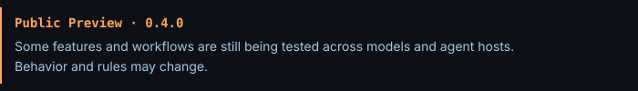

# Agent804



**Build the harness before the app.** A framework and skill set for working with coding
agents, from Node 804.

**Why.** Asking an agent to "build me an app, make no mistakes"
fails for the same reasons every time: the agent has no memory of your standards, no way to
check its own work, nothing stopping it from doing irreversible things, and it grades its own
homework. Better prompts do not fix that. A repository that holds the rules, and checks that
enforce them, does.

Agent804 comes from my own experience building several agentic line-of-business apps with
coding agents: what broke when I prompted without structure, what I changed, and what held
once the rules lived in the repository and the checks enforced them. I then
checked it against published practice from Anthropic, OpenAI, Simon Willison, Harper Reed, Addy
Osmani, Kent Beck, Birgitta Böckeler and GitHub Spec Kit, and used their work to reinforce
it: see [framework/validation.md](framework/validation.md).

**What is proven, and what is only an idea.** Many agent frameworks are written and then
assumed to work: nobody checks that agents follow them in real development. Agent804 reports
the difference. Every skill, module and mechanism carries one of four marks, and
[Evidence](#evidence) says what each one rests on.

| Mark | Means |
|---|---|
| **Proven** | Used in real development on real code more than once, and agents followed it |
| **Used once** | Used in real development once. It worked; it has not been repeated |
| **Fixture-tested** | Code in the kit passes automated tests in throwaway repositories; not yet seen working in a real host |
| **Idea** | Written and checked for consistency, never used on a real project. Agents may not follow it as written |

## Core and modules

**The core is what every project built with agents needs**, grouped into four cumulative
[levels](framework/levels.md). Each level requires every applicable gate in that level and
in every earlier level to be fully met:

| Level | What it establishes |
|---|---|
| **1 — Guided** | Repository instructions and one working check |
| **2 — Controlled** | Guardrails, a running skeleton, CI and human review |
| **3 — Verified** | Independent tests before code, architecture checks and decisions with evidence |
| **4 — Sustained** | Measurement and regular gardening |

An assessment says **“Level 2 — Controlled”**, names gaps blocking the next required level,
and reports modules separately. Partial gates block advancement; unresolved evidence is
explicitly provisional. The level describes development protections, not product correctness.

These are the primary goals. Operate is
one of them. Building an MCP server, an agent API, or an embedded model feature is development
work, scored when the project has that surface.

| Goal | What it requires |
|---|---|
| [Maintainable by people and agents](framework/maintainability.md) | One authority per business rule; units small enough to read whole; contracts and the non-obvious why, with no comment quota; obsolete code removed or recorded; new work fits the existing design; a refactor keeps behavior and records preservation. Existing code can adopt a reviewed baseline |
| [Security in development](framework/security.md) | Honest scanners, identified dependencies, and no production secrets in an agent's reach. A person reviews any change that weakens those controls. When a breach would hurt someone else: a threat model against a versioned standard, safe defaults, abuse tests first, and owned findings. A score is not a certificate |
| [One style per language](framework/rules.md#st-style-level-1) | One pinned formatter and linter per language. The check reports and does not rewrite. The language's usual style is the default (PEP 8, PSR-12). A project that keeps another style records why |
| [A person owns the work](framework/rules.md#rv-review-rv-1-at-level-2) | The person agrees criteria before code, can explain every change before merge, and is the only one who approves. Commit, push, deploy, and migrate wait for them. Agent review and a green check do not replace that |
| [Witnessed TDD and preservation](framework/testing.md) | Criteria first. Acceptance tests come from a separate context, fail for the intended reason, then pass. Existing behavior stays covered. Tests are not weakened to get green, and they assert outcomes. Failure and refusal are criteria when they matter |
| [The repository is the memory](framework/context-management.md) | A [current behavior description](framework/current-behavior.md) answers what the system does now; change specs, decisions and evidence retain proposals, reasons and history. Sessions start from current guidance and verify affected sources. Summaries and search misses are not proof |
| [The agent cannot declare success](framework/rules.md#ck-checks-levels-1-to-3) | One check covers format, lint, types, tests, architecture, and security. CI runs it on the committed tree and blocks a red merge. A red check cannot be called done. A repeated review comment becomes a check |
| [Whether the work holds](framework/rules.md#ms-measure-and-garden-level-4) | Track corrections, rework, escaped defects, flakes, and maintainability trends. Never count lines generated |
| [The AI-facing surface](framework/operate.md) | MCP servers, agent APIs, and embedded model features use one contract, a designed tool list, read-only access until a person grants write, and model output that cannot approve or publish |

**Modules cover problems a project has only in some situations.** Each has a trigger; when
it is true the module is scored and a gap is a real finding, and when it is false the module
costs nothing ([modules.md](framework/modules.md)).

| Module | Applies when | Evidence |
|---|---|---|
| **Operate** | The project builds an MCP server, an agent API or tools, or an embedded model feature. One contract; a designed tool list; read-only until a person grants write; repeats harmless; tokens issued for this server; model output cannot approve or publish | Used once: OP-1 to OP-8 come from one project's built code. OP-9 to OP-11 and the `operate` skill are ideas |
| **Security** | The system holds sensitive data, handles money or safety, writes to other systems of record, or is reachable beyond the team. Threat model, safe defaults, abuse tests and owned findings | Idea |
| **Parallel work** | Several agents or people write at once. A checkout, database and port each, and a check of the combined result | Idea. One project tried it and found isolation gaps |
| **Maintenance** (trial) | Adopting the harness onto existing code. Verified refactoring and a debt record that never waives a failing check | Idea |
| **Context** (trial) | Work spans many sessions. Evidence with a known source and age; state recoverable from the repository, not from chat | Idea |
| **Completion automation** (trial) | The developer opts into automatic end-of-turn checks. No supplied Codex integration after its failed trial | Historical Claude evidence; Grok live continuation unverified |
| **Routing** (trial) | Several models or a spend budget. Traceable assignments and cost compared against accepted outcomes | Used once: tiered subagents on one feature |

Trial modules are reported by `assess` without a score; promotion requires sufficient
successful real-project evidence and review. An attempted run alone is insufficient.

Other guides: [agent hosts](framework/agents/README.md) (Claude Code, Codex, Grok Build,
ChatGPT and custom hosts, kept separate from language profiles), and
[independent roles](framework/model-routing.md#independent-roles) (separate
contexts write the tests, the code and the review; different models are optional).

The process scales to the change: a small fix needs a focused test, not a spec, and
high-impact changes get deeper review.

## What is in it

| Path | Read by | What |
|---|---|---|
| [framework/rules.md](framework/rules.md) | Both | Every rule, with an ID and how to grade it |
| [framework/levels.md](framework/levels.md) | Both | The four cumulative core levels, scoring and project targets |
| [framework/modules.md](framework/modules.md) | Both | The modules and their triggers, and the Operate levels |
| [framework/profiles/](framework/profiles/) | Both | The Django profile, and the template `start` fills in for any other stack |
| [framework/agents/](framework/agents/) | Both | Host recipes: Claude Code, Codex, Grok Build CLI, ChatGPT and custom hosts |
| [framework/worktrees.md](framework/worktrees.md) | Both | Separate checkouts for agents or people writing at the same time |
| [testing](framework/testing.md), [maintainability](framework/maintainability.md), [security](framework/security.md), [operate](framework/operate.md), [debt](framework/technical-debt.md), [context](framework/context-management.md), [routing](framework/model-routing.md) | People | Why the rules on each topic exist, and their trade-offs |
| [framework/validation.md](framework/validation.md) | People | The published work the framework was checked against, and where it chose differently |
| [templates/](templates/) | Agents | `AGENTS.md`, specs, plans, pull requests, ADRs and evidence, project records and host action settings |
| [developer guide](framework/developer-guide.md) | People | Starting new projects, gradual adoption and daily development |
| [skills/](skills/) | Agents | The fourteen skills below |

**Two readers.** The pages marked "People" explain; skills and templates instruct, because an
agent pays for every line it loads. Skills send agents into `framework/` only for the pages
marked "Both", and the check enforces that, keeps each skill within a size budget, and fails
any rule that no skill or template acts on.

Context loads by task: small fixes use `spec` and affected project records; bounded adoption
retrieves relevant rules with their qualifications; full assessment covers the complete core
and module triggers. Only selected host/stack guidance and applicable playbooks are loaded.
The check reports skill sizes and explicit reading scenarios. Inspect them separately with
`python scripts/context_load.py --host codex` (or `claude-code`, `grok-build`, `chatgpt`);
`--json` provides per-file counts. These are character-based estimates, not live token usage;
project evidence and conditional additions remain explicit. No aggregate threshold is set.

The kit ships one language profile, Django, because it is the only stack it has been run
on. For any other stack, `start` writes a Draft profile for the project from the template,
against the real code. A profile joins the kit once it has been used on a real project; see
[profiles](framework/profiles/README.md).

| Skill | Does | Evidence |
|---|---|---|
| [`assess`](skills/assess/SKILL.md) | Existing project: the score, which modules apply, the gaps with evidence and one next action. Read-only | **Proven** under earlier scoring; 0.5 scoring untrialled |
| [`adopt`](skills/adopt/SKILL.md) | Existing project: guided creation of missing protections, one implemented increment at a time, with evidence and a resume point | Idea; isolated setup exercise only |
| [`spec`](skills/spec/SKILL.md) | Discover requirements and interaction outcomes; agree criteria sized to the change, then independent tests first | Used once, in an earlier form; 0.6 discovery additions are ideas |
| [`plan`](skills/plan/SKILL.md) | Larger agreed work: verifiable increments, dependencies, integration checkpoints and resumable handoffs | Idea; Trial workflow |
| [`decide`](skills/decide/SKILL.md) | ADRs, and the evidence recorded back once a feature is built | Used once, in an earlier form |
| [`review`](skills/review/SKILL.md) | A fresh-context review from the criteria and the real check output, deepest in red zones | Used once, in an earlier form |
| [`start`](skills/start/SKILL.md) | New project: an interview, then a running skeleton with one check command, guardrails, CI, decisions and risk zones, before any feature | Idea |
| [`refactor`](skills/refactor/SKILL.md) | Restructuring with no behaviour change: callers traced, tests green before and after | Idea |
| [`sensor`](skills/sensor/SKILL.md) | A recurring mistake becomes a check whose message says how to fix it | Idea |
| [`garden`](skills/garden/SKILL.md) | Finds stale instructions, drift and overdue follow-ups; proposes small fixes | Idea |
| [`measure`](skills/measure/SKILL.md) | Whether agent work holds: corrections, rework, escaped defects, test reliability and maintainability trends | Idea |
| [`operate`](skills/operate/SKILL.md) | MCP servers, agent APIs, and embedded model features: one contract, a designed tool list, read-only until granted | Idea |
| [`route`](skills/route/SKILL.md) | Optional: which model and effort for each role, without launching anything | Idea |
| [`context`](skills/context/SKILL.md) | Optional: gathers or recovers the evidence a long task needs, from the repository | Idea |

## Use it

The [developer guide](framework/developer-guide.md) walks through new projects, gradual
adoption of existing code and daily work, with example requests and responsibilities.

### 1. Install

Until Agent804 is in a plugin marketplace, download it from GitHub: get the latest
`agent804-<version>.zip` from the [Releases page](https://github.com/Node804/agent804/releases)
and unzip it somewhere it can
stay, for example `C:\tools\agent804` or `~/tools/agent804`. Keep the folder whole: skills
find the templates and tables by relative path, so a skill folder copied on its own breaks.

| Host | Install from the unzipped folder | Run a skill |
|---|---|---|
| **Claude Code** (desktop Code tab, terminal, web, IDE) | `/plugin marketplace add C:/tools/agent804`, then `/plugin install agent804@agent804`. The folder carries its own marketplace file | `/agent804:start` |
| **Codex** (desktop app, terminal, IDE) | Add the folder as a local plugin (it reads the root `plugin.json`), or link its skills into the project's `.agents/skills/`. Not both | Ask for the skill by name |
| **Grok Build CLI** | Follow the [Grok recipe](framework/agents/grok-build.md); confirm with `grok inspect --json` that the skills are found | Ask for the skill by name |
| **Cursor and others** | Nothing to install | "Follow `<folder>/skills/start/SKILL.md`" |
| **ChatGPT or an API chat** | See [chat hosts](framework/agents/chatgpt.md): without tools it can review what you paste, not run the check | — |

To update, replace the folder's contents with the new release (delete the old files first,
so removed ones do not linger), then in Claude Code run `/plugin marketplace update agent804`.
Host action-permission settings differ; `start` uses the [host recipes](framework/agents/README.md).
Core GR-4 requires current check evidence and truthful reporting; CI runs independently.
The 0.6 preview ships no completion adapter or Stop install recipe. Codex automatic
continuation failed despite attempted remedies; the shared Claude/Grok engine also had
known cache/input/process-bound defects. Those implementations and their adapter fixtures
are withdrawn, while action-permission settings and historical evidence remain.

GR-8 remains an opt-in Trial design for independently supported project integrations,
not a prerequisite or a shipped runtime. See the [module](framework/modules.md#completion-automation)
and [criteria](framework/agents/completion.md). Existing handlers copied into projects are
not uninstalled by updating this kit; review them separately within authorized scope.
After moving the folder, `python scripts/check_skill_resources.py <folder>` confirms paths.

### 2. First run

**New project:** run `start` in an empty folder. It asks seven questions, one at a time
(what it is, what happens if it breaks, prototype or production, stack, who reviews, whether
agents will call it, how many write at once). Then it builds a running skeleton with one check command,
guardrails, CI, risk zones and a first ADR, and proves each control by making it fail once.
It asks before the first commit.

**Existing project:** use `adopt` for guided setup, or `assess` for a read-only diagnosis.
Assessment recommends one bounded next action with optional follow-ups. Adoption walks you
through the choices and creates missing pieces, such as style conventions or a check command.
Agree one useful increment, prove what works, then resume later from the project record.
You can begin before earning Level 1; the full findings are not today's mandatory backlog.

### 3. Every change

1. **`spec`** sizes the change. A small fix gets one or two criteria in the plan; a large one
   gets an interview and a spec. You agree the criteria before any code.
   Discovery surfaces assumptions, constraints and relevant interaction states. For work
   spanning several changes, **`plan`** (Trial) divides the agreed outcome into verifiable
   increments with dependencies and integration checkpoints, using the existing plan/tracker.
2. **Tests first, in a separate context**: a fresh session or subagent writes the acceptance
   tests from the criteria and shows them failing.
3. **Build** in another fresh context until the check is green, without editing those tests.
4. **`review`** in a fresh context, from the criteria and the real check output. Then a person
   reviews before merge.

Start from the area's maintained behavior description, reusing existing README/contract docs.
`spec` records added, changed, removed and preserved behavior. Verified delivery reconciles
the description before review; proposals and history remain separate. Small projects can use
one README section. Source/test references and verification scope distinguish repository
behavior from deployed state. This 0.6 workflow is untrialled; see [limits](framework/validation/current-behavior.md).

Restructuring with no behaviour change uses `refactor` instead of steps 1 and 2.

### 4. Every so often

- A mistake the agent makes twice becomes a check, with `sensor`.
- `garden` finds stale instructions, drift and overdue follow-ups, and proposes small fixes.
- `measure` shows whether agent work holds: corrections, rework, escaped defects and test
  reliability, against the last period.

Optional: `route` when you have several models or an allowance to plan; `context` when a task
spans many sessions or the evidence is incomplete.

## What it does not do

- Decide what is worth building.
- Replace experienced maintainers or human review. Reviewers must understand the change;
  red-zone work gets deeper review.
- Guarantee correctness. Tests and reviews can miss a misunderstood requirement, and agreement
  between models is not proof.
- Enforce anything by prose alone. A hook or setting protects nothing until it has been seen
  working in the host you use.

## Evidence

**Version 0.6.0, preview candidate; publication pending.** Rules still change; see [CHANGELOG.md](CHANGELOG.md)
and [ROADMAP.md](ROADMAP.md). The reference projects are real line-of-business applications
built with coding agents; they are not named here.

**Proven**
- **`assess` under earlier scoring.** Run on two real Django repositories by independent agents
  working from the skill alone: three rounds under 0.2 and two under 0.4. Agents followed it
  without help, and scores converged once ambiguous wording was fixed. Every round also
  produced a list of places the wording made the agent guess; those lists drove most of the
  changes in 0.3 and 0.4. The cumulative 0.5 levels have not been trialled; earlier scores
  do not establish them and require fresh reassessment.

**Used once**
- **The change flow** (`spec`, separate test writing, build, `review`, `decide`) on one real
  feature, from a one-line request. The agent read the ADRs unprompted, stopped on a Proposed
  ADR (which caught a flaw in it), agreed a spec, had tests written in a separate context that
  failed for the right reason, built with the tests unchanged, reviewed, and recorded the
  evidence back. This ran with the reference project's own playbooks, which the kit's skills
  were written from. **The kit's current skill text has not yet run on a real feature.**
- **The Claude Code stop hook and permission settings**, in an earlier copy, on one reference
  project. Green runs are recorded in the real host; a block on a red check is not recorded.
- **Model routing:** fast, mid and strongest tiers for search, test writing and design over
  one feature. It found one real problem (the test writer's output did not type-check, which
  led to TS-7); it was not compared with another route, and cost was not measured.
- **Operate OP-1 to OP-8**, which describe one reference project's built and running design.
  Graded on two projects; whether they hold for other products is untested. OP-9 to OP-11
  are not part of that evidence.
- **The Django profile's unmarked mechanisms**, used on one reference project. Items marked †
  have not run anywhere.
- **Plugin install** of `assess` in Claude Code and in Codex (ChatGPT desktop app).

**Fixture-tested**
- **Kit regressions:** scoring/gate preservation, skill resources, private-name protection,
  read budgets, rule alignment and modeled context-load calculations. Historical Stop-adapter
  fixtures were retired with the withdrawn implementations; they never proved live host parity.

**Unsuccessful field trial**
- A [0.5 Codex Desktop completion trial](framework/validation/codex-desktop.md) reported
  configured/trusted discovery in a separate process and some wrapper invocations returning 2,
  but automatic continuation failed and none of the approaches tried enabled it. The Codex
  Stop integration is removed in 0.6; use direct checks and CI. The failure cause remains
  unresolved; fixture success was not active enforcement.

**Idea**
- **0.6 discovery and planning:** stronger requirements and interaction discovery in `spec`,
  plus the Trial `plan` skill for increments and integration. No real-project trial yet;
  [rationale](framework/planning.md) and [validation limits](framework/validation/planning.md).
- **0.5 guided adoption and developer journeys:** integrity-checked and independently reviewed.
  An isolated Python exercise created a partial check and resumed to document style;
  a partial real-project adoption/host trial is recorded below; successful full enforcement
  setup remains pending.
- **0.5 cumulative scoring:** gate mapping is regression-tested; assessment clarity and
  reference-project levels remain untrialled.
- **Skills not run on real projects:** `start`, `refactor`, `sensor`, `garden`, `measure`, `operate`, `route`
  and `context`, plus the small-change path of `spec`. The partial `adopt` trial does not prove
  a completed adoption workflow.
- **Modules never run where they apply:** Security, Parallel work, Maintenance and Context. One
  project's attempt at parallel worktrees found its isolation gaps.
- **Rules added or rewritten in 0.4** that no project has met yet, for example MT-2's file-size
  and duplication limits, the GR-1 exception for a read-only development credential, and
  OP-9 to OP-11 (designed tool list, embedded model features, credentials issued for this server).
- **Any stack other than Django**, and the full change flow under Codex or Grok Build.

The kit's own check (Python 3.11+ and Git):

```bash
python scripts/check.py
```

It runs regression tests (scoring, context estimates, skill paths, private names, read
budgets and rule alignment) and checks links, rule IDs, budgets and configuration syntax. It
proves the kit is consistent, not that it works: only use on real repositories moves an item
up this list, and a rule that does not survive that use is changed.

## License

[MIT](LICENSE), except [`templates/`](templates/), which is [MIT No Attribution](templates/LICENSE):
copy a template into your own project and change it freely, with no notice to keep.
